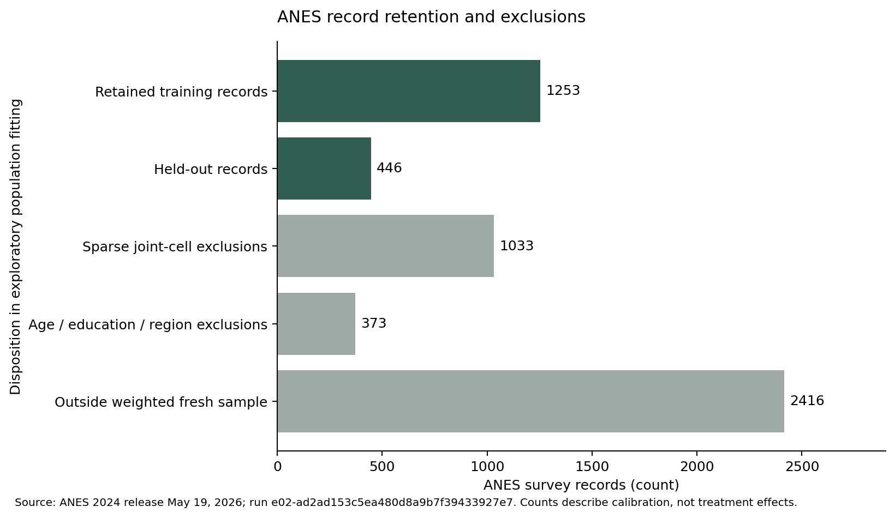
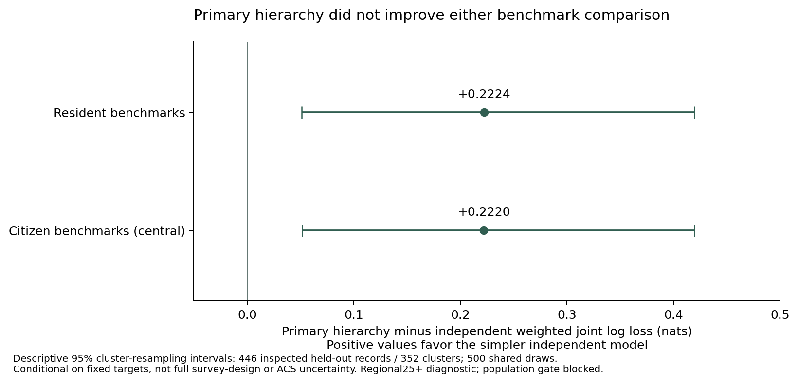
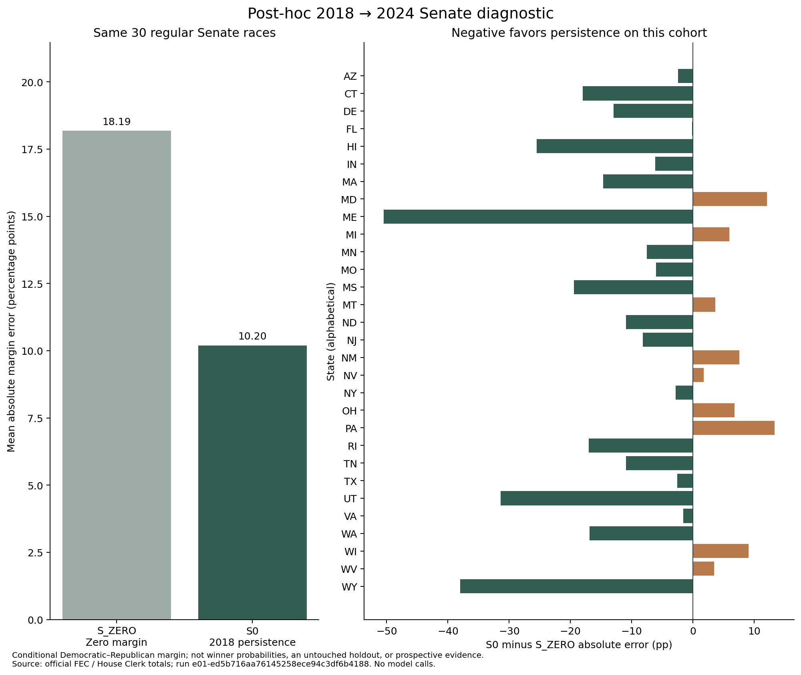

# Testing Whether Synthetic Societies Earn Their Complexity Draft

Owner-review draft, updated November 9, 2026 UTC. Not published.

A simulation can contain detailed people, convincing conversations and busy social feeds without predicting anything well. Synthetic Society Lab starts with a narrower question: what useful evidence does each extra layer add?

We are building two studies around that question. One compares election-margin forecasts with simple historical baselines. The other tests whether presenting the same information differently changes a model's answers to political survey questions. The second study concerns synthetic model responses. It does not show that real people become polarized or change their votes.

## What the laboratory can do now

The initial system preserves source files and hashes, generates fictional profiles, assigns controlled treatments, records responses and scores outcomes. It also records failures and costs. A local viewer lets a reviewer trace a displayed result back to the run that produced it and inspect the same content under paired conditions.

The first offline test crossed 12 fictional profiles with three fictional policy notices and five conditions. Its model responses were deliberately programmed fixtures. Recovering the expected difference showed that assignments, scoring and replay worked together; it did not discover a political effect.

We also fitted a small synthetic population using ANES survey associations and selected Census benchmarks. That work exposed a more substantive problem. Many combinations of characteristics had too little survey support, and suppressing sparse cells removed 1,033 training records. The remaining calibrated fit had an effective sample size of about 352. Matching a few demographic totals closely did not make it a representative electorate.

The figure shows recorded data-preparation counts, with its source run identified in the accompanying provenance file. It does not show model behavior.

## A more elaborate population model did not win

We compared a support-preserving hierarchical model with a simpler model that treats the coarsened demographic fields independently. Both used the same survey holdout and calibration targets. The primary hierarchical candidate gave worse predictive log loss: 7.16 versus 6.94, where lower is better. Independent recalculation confirmed the comparison. We retained the unfavorable result and the planned sensitivity settings rather than choosing a better-looking setting afterward.

Smoothing gave both models positive support everywhere by construction. That did not establish population validity or fix the citizenship mismatch between survey and Census universes. The population gate remains blocked. This is precisely why a convincing demographic description must earn its extra complexity.

We then repeated the matched comparison using Census citizen benchmarks, preserving the same survey holdout and model settings. The primary hierarchy still performed worse: 7.164 versus 6.942 nats. An independent reviewer recomputed all40 configurations and all66 paired contrasts, and the replay reproduced the deterministic artifacts exactly. Eight predefined rounding perturbations remain recorded alongside the central result. They explore a small set of input directions; they do not measure all Census uncertainty. The citizen benchmarks did not establish a representative nationwide adult population or validate synthetic political responses.

## Why the election study is retrospective

We have no independently verified pre-results 2026 forecast submission. A later reconstruction cannot be relabeled as a timely prediction. Historical evaluations remain useful for checking data, formulas and comparisons, but their limitations must travel with the results.

Even finding the right historical comparison takes care. Two Senate elections held two years apart generally concern different seats. District labels can stay the same while House boundaries change. Candidate-registration files can include people who were not on the final general-election ballot. Those are research problems, not details a dashboard can hide.

A separately audited historical diagnostic now compares 30 regular Senate constituencies between 2018 and 2024. Carrying forward the 2018 Democratic–Republican margin gave a mean absolute error of 10.20 percentage points; predicting a tied margin gave 18.19. The auditor independently checked all 120 official candidate counts and recomputed the errors. This is a post-hoc, conditional two-party comparison: an independent winner can be outside that denominator, and researchers saw returns while validating sources. It is not evidence of timely forecasting, agent superiority or the full 2026 study. The separate software DEMO still uses invented values.

Every state remains visible, including those where persistence performed worse. The [figure receipt](figures/e01-historical-errors.provenance.json) links its numbers to the sealed run.

## Autonomy needs independent checks

The program now separates implementation and audit across specialized chats. The independent auditor found failures that the original tests missed: a string value could enable a policy, a cancelled request could leave uncertain billing without stopping later calls, and a crash could leave a completed result without its final integrity ledger. Those issues were corrected and retested independently.

Routine work proceeds under the owner's standing authority with a shared $5 ceiling, a $1 current E02 pilot ceiling and no paid E01 inference. The earlier failed compatibility checks remain in the record; their uncertain charges were not erased to make the live pilot possible. The ledger now conservatively counts $0.002857, including historical holds. Every new batch needs a fixed request count, hard bounds and an independent technical review. Publication remains subject to owner approval.

We have also verified the downloaded bytes and limited metadata of a DC Census archive and two official election documents. This is preparation work: no DC person rows have been imported, the population is not nationally validated, and the new documents do not establish final ballots or a2026 forecasting result. An independent reviewer also caught a race in review-package assembly; the corrected builder now binds archived data to the original verified run seal.

## The first live sample is complete

We now have 32 real model responses from a small controlled pilot: four fictional party-prior profiles, two authored civic notices and matching news/social wrappers. Every answer was valid, and all eight planned comparisons were scored. The measured partisan thermometer gap did not change before versus after either wrapper in any unit. That is a result for this particular model, prompt and sample—not evidence that presentation never affects models or people.

The result also exposes limits of the test. The notices may have little bearing on partisan warmth, and each post prompt supplied the model's own baseline answer. Half the matched comparisons cross a multi-day gap after the original run stopped following a billing lookup that returned HTTP404. The calculated `[0,0]` bootstrap interval simply reflects all-zero observed contrasts; it does not prove equivalence. The next useful step is to examine measurement sensitivity and baseline anchoring under a frozen matched design, not repeat the same sample in search of a different answer.

All 32 research bills were verified and total $0.0014340. An independent auditor checked the raw evidence, preserved financial history and scores. The [live report](../reports/E02_LIVE_PILOT_COMPLETE_20261108.md) records what ran and its limitations. The original stopped run is still preserved, and no missing response was invented or resent.

## What still has to earn a place

The next steps include reviewed real-text stimuli, a defensible population scope, a human-study anchor, model-family robustness and a separately frozen sensitivity design beyond the completed limited pilot. Demographic detail must outperform a simpler control on the same task. A social wrapper must be compared with identical words and attribution. Assistant interaction needs a matched comparison. A group of agents must justify itself against independent agents using comparable computation.

No amount of visual realism can satisfy those tests on its own. A negative result would still be useful if the comparison is reproducible and its limits are clear.

The full study is not complete. The [technical draft](TECHNICAL_PAPER_DRAFT.md), [limitations report](LIMITATIONS.md) and [completion status](../reports/STATUS.md) explain what the available evidence supports. These materials are drafts for review, not a published account of human political behavior.
