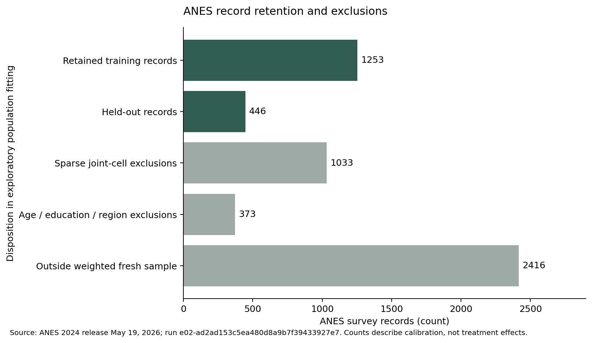
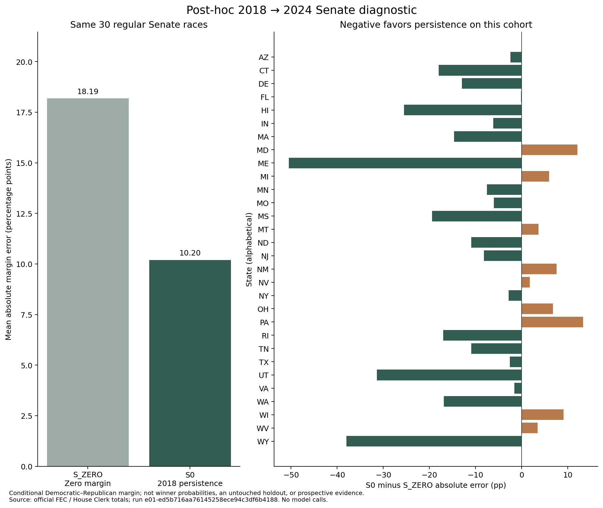

# Synthetic Society Lab Methods and Validation Draft

Draft for owner and independent scientific review. November 3, 2026. No external release or institutional affiliation is authorized. This version reports engineering/data-preparation evidence and an independently checked post-hoc historical baseline comparison. Real-model E02 effects and the original full E01 study remain unexecuted.

## Abstract

Synthetic social-science systems can become more elaborate without becoming more useful. Synthetic Society Lab separates that question into electoral-margin forecasting and randomized information-framing experiments on fictional model profiles. A shared system records source provenance, frozen configurations, isolated experimental units, provider accounting and reproducible evaluation. An initial engineering snapshot includes an ANES/ACS population fit, deterministic response fixtures and a retrospective forecasting demonstration. In the recorded population fit, sparse support excluded 1,033 training records and the effective survey sample size was approximately 352 despite matching selected demographic margins closely. These observations limit representative-population claims. The deterministic response pilot verifies recovery of an authored test effect and does not estimate a language-model or human treatment effect. In a separately audited post-hoc diagnostic on 30 regular Senate constituencies, 2018-margin persistence had mean absolute error 10.20 percentage points for 2024 conditional Democratic–Republican margins, versus 18.19 for a zero-margin control. This selected historical comparison is not a prospective forecast or an untouched holdout. Complexity is eligible for adoption only after a matched comparison with a simpler approach. The present contribution is the research design, reproducibility machinery and explicit account of what remains scientifically unproven.

## Research question and related work

The program asks whether demographic grounding, dated information, social presentation, assistant mediation and agent interaction add predictive or inferential value beyond less costly controls. E01 evaluates election-margin predictions against actual returns. E02 estimates changes in the responses of particular model/provider configurations under randomized information treatments. Neither objective equates realistic dialogue with accurate voter modeling.

Argyle and colleagues studied demographic conditioning and algorithmic fidelity in synthetic samples. Their results motivate testing conditional response patterns rather than judging a simulation by its prose alone. [Argyle et al., 2023](https://doi.org/10.1017/pan.2023.2)

Bisbee and colleagues compared synthetic survey responses with ANES data and reported problems with variation, associations and robustness despite similarities in some averages. This motivates keeping marginal calibration, joint associations and downstream inference as separate validation questions. [Bisbee et al., 2024](https://doi.org/10.1017/pan.2024.5)

Aher and colleagues demonstrated a framework for testing model simulations against human experiments and identified systematic distortions. Their work supports using known experimental benchmarks while treating successful replication of one pattern as narrower evidence than general human fidelity. [Aher et al., 2023](https://proceedings.mlr.press/v202/aher23a.html)

The current study has not replicated a matched human exposure experiment. Those papers provide context and evaluation ideas, not an external human control group for E02.

## Research program and data

One monorepo contains shared provenance, execution, logging and financial controls, with independent E01–E04 protocols. E01 and E02 are the current priorities. E03 would add aggregate city geography and E04 would test independent verification in fictional government cases; neither has executed a study.

Received inputs include the May 19, 2026 ANES 2024 release, its codebook and questionnaires; ACS 2024 five-year age, race/ethnicity, education and household-income tables; historical election returns; candidate and committee records; congressional block assignments; partial dated ratings PDFs; and a GDELT metadata fixture. Source integrity, source authenticity, legal reuse and suitability for an estimand are distinct properties. A valid checksum establishes only the obtained bytes.

The four initial ACS tables cover the 50 states, DC and Puerto Rico. Puerto Rico is retained in source files but excluded from the initial 50-state-plus-DC design. Extra ACS one-year age data are not mixed with five-year benchmarks. Candidate registration and campaign-finance records do not establish general-election ballot eligibility. Congressional assignment files do not establish a verified historical crosswalk. The GDELT batch is not article text or proof of a pre-election publication archive.

Current source-specific evidence is indexed in [source notes](../docs/DATA_SOURCES.md), the [source inventory](../configs/SOURCE_INVENTORY.json), and worker/audit receipts under `reports/`. Newly obtained real inputs require independent acceptance before supporting a scientific result.

## E02 Population and instrument

The initial population fit uses fresh combined pre-election ANES records, V240103a weights, and their corresponding survey design identifiers. A cluster-based holdout reserves records for descriptive out-of-sample checks. The engineering population is restricted to age 25+ so that the age and education calibration tables have a compatible age universe.

Weighted coarsened joint cells preserve observed associations among region, age band, education, party, race/ethnicity and income category. Cells with fewer than five contributing training records are suppressed. Iterative proportional fitting adjusts supported cells to region-age and region-education margins. Demographic attributes are not drawn independently. Three education categories replace an infeasible five-category specification after structural-zero checks; that exploratory revision preceded model execution.

ANES covers adult citizens while the selected ACS margins cover residents. The race table covers all ages and the income table counts households. Consequently, neither race nor household-income margins are imposed on the 25+ person weights, and the population cannot be described as a representative electorate. Fictional profiles expose coarsened categories without survey respondent identifiers, exact ages, addresses or individual survey thermometer answers.

The primary instrument uses the ANES party feeling thermometers V241166 and V241167, each scored 0–100. Fixed prior major-party identification determines in-party and out-party orientation. The time-point score is in-party warmth minus out-party warmth; its range is −100 to 100. The primary contrast is the mean C2-minus-C1 difference in before/after change on identical profile × stimulus × repetition units. Change can range from −200 to 200 and difference-in-changes from −400 to 400. Division by 100 is a range normalization, not a standard-deviation effect.

Independent and unknown-party profiles remain in quality and exploratory absolute-gap reporting but are excluded from the primary estimand by definition. Missing, refusal, invalid, negative-code and out-of-range responses are not imputed. Exact wording, recodes, exclusion rules and scoring are versioned in the [instrument](../configs/e02_instrument.json) and [E02 protocol](../protocols/E02_INFORMATION_EFFECTS.md). The full questionnaire's cover date differs from its supplied filename; release-specific variable mapping governs the implementation while the discrepancy remains documented.

## E02 Treatments and analysis

C0 receives no policy content. C1 receives a source-labeled news/document card and C2 the identical underlying words and attribution in a simulated social-post wrapper. Text-only presentation tests framing cues; it does not test visual scrolling or an actual platform recommender. C3/C4 add matched source-bounded Q&A. Existing offline demonstrations use scripted Q&A, not a live assistant.

The design is fully crossed within profile and stimulus, with randomized execution order and independent contexts. A post-exposure request sees only its own baseline response and assigned treatment. Primary units and scoring rules are fixed before evaluating outcomes. Failures and exclusions remain part of the recorded quality evidence rather than disappearing from denominators.

The planned uncertainty analysis respects shared profiles and stimuli. A crossed bootstrap is implemented for engineering checks, but a small number of stories and a deterministic fixture cannot establish a scientific confidence interval. A real-model analysis requires adequate stimulus diversity, repeated seeds, prompt sensitivity, model/provider robustness, and an accepted population and source protocol. Calibration of human survey inputs does not validate the model's response mechanism.

## E01 Retrospective forecasting design

E01 predicts signed Democratic-minus-Republican two-party margin in percentage points. S0 carries forward the prior same-seat margin with explicit frozen national and incumbency adjustments. House comparisons require verified geography consistency or justified reaggregation. Regular Senate same-seat comparisons normally require a six-year lag; substituting 2022 Senate returns for 2024 prior same-seat returns is invalid.

The race sample, candidate eligibility, geography, dates and exclusions must be frozen without selecting for forecast performance. Features cross an allowlist into a separate prediction process; outcomes enter the evaluator after the prediction artifact is sealed. The trusted worker receives a stripped environment and temporary working directory, with runtime I/O guards. These controls cannot prove that an operator never saw an outcome and are not an adversarial OS sandbox.

All methods must use identical evaluation races and outcome definitions. Macro mean absolute margin error, signed bias and race-level paired differences take precedence over visually persuasive simulations. Small, correlated race samples cannot support general superiority claims. Historical model training may contain outcomes, so even a carefully sealed retrospective test does not establish prospective validity. No independent pre-results 2026 submission has been demonstrated.

## Observed engineering and calibration evidence

The frozen engineering snapshot at source commit `675b0c14c80905852fe743cf6a1b6df1cc2fbc1d` provides a traceable initial reference. It is not a final acceptance certificate; subsequent independent findings and corrections are recorded separately.

Population run `e02-ad2ad153c5ea480d8a9b7f39433927e7` retained 1,253 training records in 139 supported joint cells, reserved 446 held-out records and excluded 1,033 sparse-cell training records. Another 2,416 records fell outside the selected weighted fresh sample, and 373 failed the age/education/region criteria. These counts account for the 5,521 supplied records. The fit converged in 246 iterations with maximum marginal residual approximately 9.70×10⁻⁹, effective sample size approximately 352, maximum calibration factor approximately 5.40 and held-out party-share discrepancy approximately 5.70 percentage points. Convergence verifies selected moment matching, not representativeness.

Figure 1. Descriptive record disposition for the recorded exploratory fit. Counts and provenance are in [the figure receipt](figures/population-record-disposition.provenance.json). These are real data-preparation observations, not treatment effects.

Mock run `e02-0121548188194f04936b85c984ee677f` crossed 12 fictional profiles, three fictional stories and five arms, producing 180 units and 360 mocked pre/post calls. It recovered a deliberately programmed two-point contrast. The resulting [2,2] resampling interval is a known fixture property. It is not an estimated AI or human effect. A replay produced the identical response hash `8675da5f1ae4dd5cb4226f5b9b8997234abf8b9626f646d634d9508c747a077a`.

The original E01 DEMO uses invented values to test formula, freezing and evaluation paths. Its error values are not reported here as election performance. A separate readiness audit inspected 2,193,786 rows across received election files and identified missing/redacted votes, malformed values, mixed reporting modes and comparable-seat gaps. The separate real historical diagnostic below has its own source adjudications, run IDs and independent audit; it does not relabel the DEMO as real.

## Exploratory population comparison: complexity not promoted

A separate [support-comparison plan](../configs/e02_population_support_plan.json) fixes a 2,880-cell target over the same six coarsened fields. Both new candidates retain all 2,286 eligible training records and use the same 446 held-out records and resident ACS calibration. The simpler candidate multiplies smoothed marginal distributions. The hierarchical candidate uses region-age-education structure, conditional party and conditional race-income with a primary parent prior strength of five. A common small uniform floor makes all log losses finite, while raw support remains separately reported. Positive support from smoothing is imposed, not discovered.

Runs `e02-247f0495823245aab66a877d623ea310` and `e02-06300b9b21d14dac927e702ec7851f56` have identical aggregate comparison hashes. The [independent auditor](../reports/INDEPENDENT_AUDIT_E02_SUPPORT_COMPARISON.json) separately reconstructed cohort recodes, distributions, calibration, losses and paired cluster resampling from raw survey inputs without importing the worker's fitting/scoring functions.

Lower weighted log loss is better. The independent candidate scored **6.93936 nats** and the primary hierarchical candidate **7.16178 nats**. The paired hierarchical-minus-independent difference was **+0.22242 nats**, with descriptive 352-cluster resampling interval [0.05118, 0.41953]. Prior strengths one and twenty remain reported sensitivities; no best-prior selection or automatic promotion occurs. The original suppressed model scored 19.62295 nats under the declared floor, retained 47.80% of training survey weight and covered only 38.74% of held-out weight. Its absolute loss depends materially on that floor.

Thus the primary hierarchical configuration has not earned adoption over its simpler comparator on this already-inspected holdout. This is an exploratory model-development result, not confirmatory inference or proof that independence correctly models humans. Citizenship/resident mismatch, transported political response validity and state representativeness remain unresolved. The original population acceptance gate stays blocked, and neither candidate is silently substituted into the frozen response pilot.

## Bounded real historical result

The [bounded Senate protocol](../protocols/E01_SENATE_2018_2024_DIAGNOSTIC.md) begins with all 33 regular Class-I constituencies. Eligibility requires a Democratic and Republican nominee in both 2018 and 2024. California (2018 D–D), Nebraska (no 2024 Democrat) and Vermont (no Democrat) are structurally excluded, leaving 30 states. Maine remains included despite its independent winner because the stated target is the conditional D–R margin, not winner probability. This denominator can produce very different results from an all-candidate vote-share task.

S0 carries forward the 2018 margin with zero national or incumbency adjustments. S_ZERO predicts zero margin. Both use identical races, feature-availability rules and outcomes. MEDSL discovery totals disagreed with authoritative FEC/House Clerk publications in nine candidate counts. Those discrepancies and their explicit corrections remain recorded; no disagreeing race was removed to improve performance. Researcher access to outcomes during source validation prevents any untouched-holdout interpretation.

Run `e01-ed5b716aa76145258ece94c3df6b4188` and its exact-summary replay `e01-9a3e3305877f40b3a84e63bd5ca5ed1c` record the results. Independent review used a separate PDF extraction method to reconcile all 120 official candidate counts, visually checked all nine corrections, reconstructed eligibility and recomputed margin errors from saved values. The [independent receipt](../reports/INDEPENDENT_AUDIT_E01_HISTORICAL.json) accepts only this bounded diagnostic.

S0 macro MAE was **10.1993 percentage points**, versus **18.1883** for S_ZERO. The mean paired S0-minus-S_ZERO absolute-error difference was **−7.9890 points**. Leaving out one state at a time produced paired means from −8.7247 to −6.5241 points; that range is descriptive sensitivity, not a sampling confidence interval. No coefficients or agents were fitted, and model/API cost was zero.

Figure 2. Identical 30-state cohort and conditional D–R denominator for both methods. The left panel shows macro MAE; the right shows every state in alphabetical order, preserving unfavorable differences. Errors are recomputed from the checksum-verified saved margins. [Figure provenance](figures/e01-historical-errors.provenance.json) identifies the exact run, ledger hash and numerical rows. These results do not show agent value, general forecasting superiority or prospective performance. Original 2026 House/Senate and comparable-agent requirements remain incomplete.

## Operational independence and costs

Three specialized chats separate E02 implementation, E01 implementation and independent audit. The auditor does not write the code it certifies. During initial audit, injected probes found false-like flag enablement, cancellation accounting and interrupted-finalization failures that the existing tests had missed. The lead corrected those issues and the auditor independently reproduced the remedies. This is evidence for independent adversarial review, not a claim that all remaining defects are absent.

OpenRouter is the only network inference gateway. The current approved model/API budget is $0 and no paid model experiment has executed. Durable reservations enforce configured total/module caps before dispatch; uncertain billing consumes its reservation and halts further requests. Known charges remain recorded even when content parsing fails. No automatic retries, fallback providers or substitutions are enabled. Positive budgets, rotated/verified credentials, actual provider pricing and a reviewed run protocol remain prerequisites for paid trials.

## Reproducibility and review status

Code, protocols, input hashes, seeds, environment metadata, responses, failures and checksum ledgers support reconstruction of each recorded run. The reproducibility package includes permitted code/configuration and explicitly selected sealed outputs; raw survey and publisher data are excluded. Full source reconstruction still depends on documented access and matching source bytes. The [completion contract](../configs/completion_contract.json) requires independent evidence for every item, including remote CI and genuine research evaluation. Local engineering checks cannot substitute for those requirements.

The [complete limitations report](LIMITATIONS.md), [current status](../reports/STATUS.md), independent audit receipts and source-specific rights notes govern interpretation. This manuscript is ready for methods review as a draft, not for a claim that the complete E01/E02 research program has finished. Further empirical sections require separately accepted real-run evidence; this bounded historical result does not certify the complete program.

## Data and software statement

The project repository is [secondary-inc/synthetic-society-lab](https://github.com/secondary-inc/synthetic-society-lab). New local changes may not yet be uploaded while GitHub authentication is unresolved. No public website, paper submission, affiliation claim or external political activity has been authorized. Instructions for the local review package appear in [REPRODUCIBILITY.md](REPRODUCIBILITY.md).
